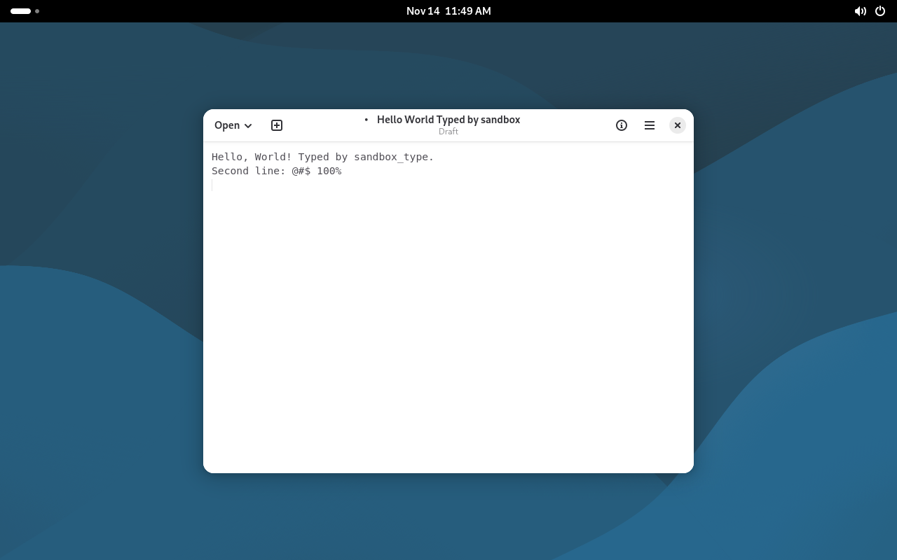
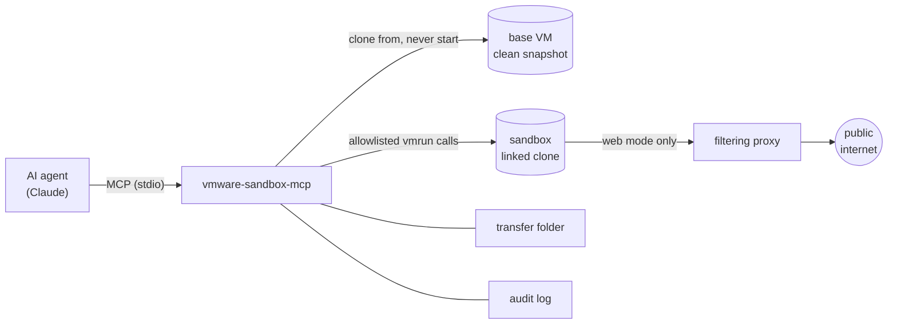

<div align="center">

# vmware-sandbox-mcp

**Give your AI agent a disposable computer.**

An MCP server that lets Claude and other AI agents create a real Linux virtual machine,<br>
run anything in it, and throw it away. It runs on your own PC with VMware Workstation.

[](https://github.com/rumenjordanov/vmware-sandbox-mcp/actions/workflows/tests.yml)
[](LICENSE)
[](pyproject.toml)
[](#requirements)
[](https://modelcontextprotocol.io)

[Quick start](#quick-start) · [Tools](#tools) · [Network modes](#network-modes) · [Security](#security) · [Setup guide](docs/setup.md)



<sub>A real sandbox: the agent logged in, opened the text editor and typed, using only the tools below.</sub>

</div>

## Why

You want an agent to run an install script from a forum, try an unknown package, or click through a desktop program. You do not want it doing that on your own machine.

- **A full virtual machine, not a container.** Each sandbox is its own VM with its own kernel, created from a clean snapshot (about 25 seconds on the test machine) and deleted when the agent is done.
- **The agent never sees VMware.** It gets 18 plain tools: create a computer, run a command, copy files, look at the screen, click, scroll, drag, type, save a checkpoint and roll back to it, destroy. This is deliberately not a general VMware management server.
- **Your other VMs are off limits.** The server can only touch virtual machines it created itself. That is enforced in code and covered by tests, not left to the agent's good behaviour.
- **Internet without your home network.** In `web` mode a sandbox can download from public websites but cannot reach your PC, your router or anything else on your network.
- **Everything is logged.** Every command, file copy, click and web request goes into an audit log the agent cannot read or change.
- **Local.** No cloud account, no API key, no per-minute billing. It needs VMware Workstation and Python, nothing else.

## What you can ask for

> I found `install.sh` on a forum. Put it in a sandbox, run it with web access, and tell me what it actually does before I run it for real.

> Start a sandbox, install nginx, serve this folder with it and check that the page loads.

> Open the text editor in a sandbox, type a short note, save it, and show me a screenshot.

For the first one, the agent:

1. calls `sandbox_create(network="web")` and gets a `sandbox_id` back;
2. calls `sandbox_copy_in` to copy `install.sh` from your transfer folder into the sandbox;
3. calls `sandbox_run` to execute it, then again to inspect new files, processes and services;
4. calls `sandbox_copy_out` to save a report into your transfer folder;
5. calls `sandbox_destroy`. Whatever the script did is gone.

## How it works



Every sandbox is a linked clone of one powered-off snapshot of a Linux VM that you prepare once. Before a clone boots for the first time, its settings are rewritten: no shared folders, no clipboard, no USB, no CD-ROM, and no network unless the agent asked for one.

## Requirements

- A **Windows host** with VMware Workstation Pro and its `vmrun` command-line tool. Developed and tested on Workstation 25H2 (vmrun 1.17.0) on Windows 11. Linux hosts are not supported.
- **Python 3.11** or newer.
- A **Linux virtual machine** to use as the base image. Debian 13 is what this was tested with.

## Quick start

**1. Prepare the base VM** (once). Create a Debian VM in VMware Workstation and run [`scripts/prepare-base-vm.sh`](scripts/prepare-base-vm.sh) inside it. It installs the guest tools, sudo and everyday tools, and sets the desktop up to log in by itself. Then shut the VM down completely and take a snapshot named `clean`. Details: [setup guide](docs/setup.md#base-vm-setup).

**2. Add the server to your MCP client.** For Claude Code, put this in `.mcp.json`:

```json
{
  "mcpServers": {
    "vmware-sandbox": {
      "command": "uvx",
      "args": ["--from", "git+https://github.com/rumenjordanov/vmware-sandbox-mcp", "vmware-sandbox-mcp"],
      "env": {
        "VMSANDBOX_BASE_VMX": "E:\\Virtual Machines\\sandbox-base\\Debian 13.x 64-bit.vmx",
        "VMSANDBOX_SNAPSHOT": "clean",
        "VMSANDBOX_CLONES_DIR": "E:\\vmsandbox-clones",
        "VMSANDBOX_TRANSFER_DIR": "E:\\vmsandbox-transfer",
        "VMSANDBOX_GUEST_USER": "${VMSANDBOX_GUEST_USER}",
        "VMSANDBOX_GUEST_PASSWORD": "${VMSANDBOX_GUEST_PASSWORD}"
      }
    }
  }
}
```

The Claude Desktop version is in the [setup guide](docs/setup.md#claude-desktop). The package is not on PyPI yet; `uvx` and `pip` install it straight from this repository:

```
pip install git+https://github.com/rumenjordanov/vmware-sandbox-mcp
```

**3. Check the setup.** With the same variables set in a terminal:

```
vmware-sandbox-mcp doctor
```

It verifies the settings, creates one test sandbox, runs a command in it and deletes it again. Every problem is printed with what to fix.

**4. Ask your agent** to create a sandbox and do something in it.

## Tools

| Tool | What it does |
|---|---|
| `sandbox_create(network, memory_mb, cpus, image)` | New sandbox from a base image. `network` is `"none"` (default), `"web"` or `"nat"`. `memory_mb` and `cpus` are optional: smaller than the base VM by default, never larger than you allow. `image` picks one of the images you offer (default: the main one). Returns a `sandbox_id`. |
| `sandbox_images()` | The base images a sandbox can start from, and what each contains. |
| `sandbox_run(sandbox_id, command, timeout_seconds)` | Runs a bash command. Returns stdout, stderr, exit code, and whether it timed out. |
| `sandbox_start(sandbox_id, command)` | Starts a command that keeps running in the background (a server, a long build). Returns a `job_id` at once. |
| `sandbox_check(sandbox_id, job_id)` | Whether a background command is running, exited or stopped, its exit code, and its output so far. |
| `sandbox_stop(sandbox_id, job_id)` | Stops a background command and the programs it started. |
| `sandbox_copy_in(sandbox_id, host_path, guest_path)` | Copies a file or a whole folder from the transfer folder into the sandbox. |
| `sandbox_copy_out(sandbox_id, guest_path, host_path)` | Copies a file or a whole folder from the sandbox into the transfer folder. |
| `sandbox_screenshot(sandbox_id)` | PNG of the sandbox's screen. |
| `sandbox_click(sandbox_id, x, y, button, double)` | Clicks at a pixel position of the screenshot. |\n| `sandbox_scroll(sandbox_id, x, y, direction, amount)` | Turns the mouse wheel at a position, to scroll what is under it. |\n| `sandbox_drag(sandbox_id, from_x, from_y, to_x, to_y, button)` | Drags with the mouse: moves a window, selects text, drags a file. |
| `sandbox_type(sandbox_id, text)` | Types text on the sandbox's keyboard. |
| `sandbox_key(sandbox_id, keys)` | Presses a key or shortcut, such as `Return` or `ctrl+c`. |
| `sandbox_checkpoint(sandbox_id, name)` | Saves the sandbox's disk under a name (about 25 seconds; the sandbox restarts). Up to 5 per sandbox. See [checkpoints](docs/setup.md#checkpoints). |
| `sandbox_restore(sandbox_id, name)` | Rolls the sandbox back to a checkpoint (about 25 seconds), undoing everything done since. |
| `sandbox_destroy(sandbox_id)` | Powers off and deletes the sandbox. |
| `sandbox_list()` | Active sandboxes with age and network mode. |

The three keyboard and mouse tools are off until you [switch them on](docs/setup.md#keyboard-and-mouse).

## Network modes

| Mode | What the sandbox can reach | Host setup |
|---|---|---|
| `none` (default) | Nothing. The sandbox has no network adapter. | none |
| `web` | Public websites over HTTP and HTTPS, through a filtering proxy on the host. Not your computer, not your home network, no other protocols. | one-time, needs admin rights: [web mode setup](docs/setup.md#web-mode-setup) |
| `nat` | The whole internet, **and also your host and your local network**. | none |

Use `web` whenever a task needs to download something. Keep `nat` for code you trust.

Measured from inside a real sandbox on the test machine:

| Target | `nat` | `web` |
|---|---|---|
| Public websites | reachable | reachable, through the proxy |
| Host's file-sharing ports (135, 139, 445) | **open** | no answer |
| Home router | **answers** | unreachable |
| Internet without the proxy | reachable | unreachable |

## Configuration

All configuration is through environment variables. If a required one is missing or wrong, the server still starts so your client can list the tools, but every tool call is refused with the reason, and nothing is created or touched. `vmware-sandbox-mcp doctor` shows what to fix.

<details>
<summary><b>All settings</b></summary>

<br>

| Variable | Required | Default | Meaning |
|---|---|---|---|
| `VMSANDBOX_BASE_VMX` | yes | | Full path of the base VM's `.vmx` file. |
| `VMSANDBOX_SNAPSHOT` | yes | | Name of the powered-off snapshot to clone from. |
| `VMSANDBOX_CLONES_DIR` | yes | | Folder where sandboxes live. Created if missing. Use it for nothing else. |
| `VMSANDBOX_TRANSFER_DIR` | yes | | The only host folder `copy_in` / `copy_out` can read or write. Created if missing. |
| `VMSANDBOX_GUEST_USER` | yes | | Login name inside the base VM. |
| `VMSANDBOX_GUEST_PASSWORD` | yes | | Password for that login. |
| `VMSANDBOX_MAX_SANDBOXES` | no | `3` | Maximum sandboxes existing at once. |
| `VMSANDBOX_IMAGES` | no | only the default | Other snapshots of the base VM an agent may start from, as `name=description;name=description`. See [several base images](docs/setup.md#several-base-images). |
| `VMSANDBOX_MAX_MEMORY_MB` | no | the base VM's memory | The most memory an agent may ask for when it creates a sandbox. |
| `VMSANDBOX_MAX_CPUS` | no | the base VM's CPUs | The most CPUs an agent may ask for. |
| `VMSANDBOX_MAX_AGE_MINUTES` | no | `120` | Sandboxes older than this are destroyed automatically. |
| `VMSANDBOX_BOOT_TIMEOUT_SECONDS` | no | `180` | How long `sandbox_create` waits for the guest to become ready. |
| `VMSANDBOX_VMRUN_PATH` | no | auto-detected | Full path of `vmrun` if it is not in the standard location. |
| `VMSANDBOX_AUDIT_LOG` | no | `audit.jsonl` in the clones folder | File the audit log is appended to. |
| `VMSANDBOX_REMOTE_INPUT` | no | off | `on` enables the keyboard and mouse tools. See [keyboard and mouse](docs/setup.md#keyboard-and-mouse). |
| `VMSANDBOX_WEB_VNET` | no | | Dedicated host-only VMware network for `web` sandboxes, for example `VMnet9`. Setting it (together with the next one) switches `web` mode on. |
| `VMSANDBOX_WEB_PROXY_HOST` | no | | This computer's IP address on that network. The proxy listens only there. |
| `VMSANDBOX_WEB_PROXY_PORT` | no | `3128` | Port the proxy listens on. |
| `VMSANDBOX_WEB_PORTS` | no | `80,443` | Destination ports `web` sandboxes may connect to. |
| `VMSANDBOX_WEB_ALLOW` | no | any public site | Comma-separated sites `web` sandboxes may reach, for example `pypi.org, *.debian.org`. See [allowing only some sites](docs/setup.md#allowing-only-some-sites). |

The clones folder, the transfer folder and the base VM folder must not overlap; the server checks this at startup.

</details>

## Security

The short version of what is enforced in code and covered by tests:

- **Only its own VMs.** Every VMware call goes through one wrapper with a command allowlist and a path check. The base VM can only be read and cloned from, never started, changed or deleted.
- **Only what it marked gets deleted.** A folder is removed only if the server created and marked it.
- **Isolated before first boot.** Shared folders, clipboard, drag-and-drop, USB, CD-ROM and sound are removed from every clone.
- **No network unless asked for**, and `web` mode refuses private addresses, the host's own addresses and non-web ports. It can also be limited to a list of sites you name.
- **One transfer folder.** File copies cannot leave it: path traversal, links and hostile archives are rejected.
- **No host shell.** Agent-supplied text is never placed on a command line, on the host or in the sandbox.
- **Limits.** Timeouts on every command, a cap on sandboxes, automatic removal of old and orphaned ones.

It also has real limits, and they are written down rather than hidden: a sandbox is exactly as contained as a VMware VM, `nat` mode can reach your local network, and anything that comes out of a sandbox is untrusted. Read the full [security model and its limits](docs/security.md) before pointing it at code you consider hostile.

To report a vulnerability, see [SECURITY.md](SECURITY.md).

## Status

Version 0.1. It works and is tested, and it is young.

- **Tested on one setup:** Windows 11, VMware Workstation 25H2, Debian 13 guest.
- **Not on PyPI yet.**
- **Keyboard and mouse** assume a US keyboard layout.
- **Planned:** isolating `web` sandboxes from each other, a PyPI release.

Bug reports and pull requests are welcome. If this is useful to you, a star helps other people find it.

## Development

```
uv venv
uv pip install -e ".[dev]"
.venv\Scripts\python -m pytest
```

The unit tests (more than 450) replace the `vmrun` process with a fake, so the real wrapper and its path guard are exercised in every test and no VMware installation is needed. They run on GitHub Actions on every push.

End-to-end test against your real base VM, with the environment variables set:

```
.venv\Scripts\python scripts\e2e.py
```

## License

MIT. See [LICENSE](LICENSE).
