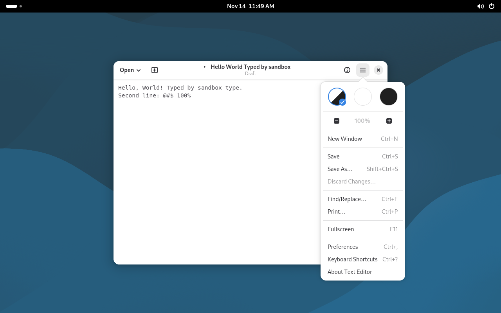

# Setup guide

Everything needed to go from a fresh VMware Workstation install to an agent using sandboxes. The [README](../README.md) has the short version.

Contents: [Base VM](#base-vm-setup) · [Check your setup](#check-your-setup) · [Claude Code](#claude-code) · [Claude Desktop](#claude-desktop) · [Web mode](#web-mode-setup) · [Keyboard and mouse](#keyboard-and-mouse) · [Checkpoints](#checkpoints)

## Base VM setup

1. Create a Linux VM in VMware Workstation (Debian 13 is what this was tested with; Ubuntu should work). Keep it in its own folder, and leave its network adapter on NAT while you set it up, so it can download packages.
2. Create the user account the server will log in as. Its name and password go into environment variables, never into this repository.
3. Run the setup script **inside the VM**. It checks what is missing, shows you, and asks before it changes anything:
   ```
   wget -O /tmp/prepare-base-vm.sh https://raw.githubusercontent.com/rumenjordanov/vmware-sandbox-mcp/main/scripts/prepare-base-vm.sh
   su -
   bash /tmp/prepare-base-vm.sh debian
   ```
   Replace `debian` with the account from step 2. It is safe to run again; it only changes what is not already right.
4. **Shut the VM down completely** (not suspend), then take a snapshot, for example named `clean`. Every sandbox is a linked clone of this snapshot.
5. Do not delete or move the base VM or that snapshot while sandboxes exist; linked clones read from it.
6. From the host, run `vmware-sandbox-mcp doctor` to check the whole chain.

To update the base image later: boot the base VM, make changes, power off, take a new snapshot, and point `VMSANDBOX_SNAPSHOT` at it.

### What the script changes

| Step | What it does | Where |
|---|---|---|
| packages | installs `open-vm-tools`, `sudo`, and everyday tools: git, curl, wget, build-essential, python3 with pip and venv, zip and unzip, jq | apt |
| sudo | passwordless sudo for that one account, and `sudo` keeps the web-mode proxy settings, so plain `sudo apt-get install` works in a `web` sandbox | `/etc/sudoers.d/vmsandbox` |
| autologin | the desktop logs that account in by itself, so screenshots show a desktop and not a login screen (GNOME with GDM only) | `/etc/gdm3/daemon.conf`, original kept as `daemon.conf.vmsandbox-original` |
| desktop | no screen lock, no blank screen, no animations, no background update downloads (GNOME only) | `/etc/dconf/profile/user`, `/etc/dconf/db/local.d/00-vmsandbox` |
| updates | switches off the background `apt` updates that can hold the package lock right after a sandbox boots | masks `apt-daily` and `unattended-upgrades` units |

Options: `--check` only reports and works without root (exit code 0 means ready), `--no-tools` skips the everyday tools, `--no-autologin` leaves the login screen alone, `--keep-updates` leaves background updates on, `--yes` skips the question, and `--force` allows running on something that is not a VMware VM. The script refuses to change anything on a machine that is not a VMware VM, because it gives an account passwordless sudo and logs it in automatically. It must never run on your real computer.

Things to know:

- **Code in a sandbox can now use sudo**, so inside a sandbox it is root. That is the point of a throwaway VM, but it also means the base VM should hold nothing private: do not log in to personal accounts in it, because every sandbox starts as a copy.
- **The base VM no longer updates itself.** Update it by hand now and then (boot it, `apt-get update && apt-get upgrade`, power off, new snapshot).
- **Per-user desktop settings win** over the defaults the script writes. If you changed one of these settings for your account in the base VM, the script's value does not apply to it.
- **To see what is missing without changing anything**, run `bash prepare-base-vm.sh --check debian` as the ordinary account. This works inside a sandbox too, which is a way to check a snapshot without starting the base VM.

## Check your setup

With the environment variables from the [configuration table](../README.md#configuration) set, run:

```
vmware-sandbox-mcp doctor
```

It checks the settings, `vmrun`, the snapshot (exists and was taken powered off), both folders and the audit log. It then creates one test sandbox, logs in, runs a command and destroys it again, which takes about a minute. Each problem is printed with what to fix, and the exit code is 0 only if nothing failed. `doctor --no-boot` skips the test sandbox.

## Claude Code

Add to `.mcp.json` in your project (or your user-level MCP configuration):

```json
{
  "mcpServers": {
    "vmware-sandbox": {
      "command": "uvx",
      "args": ["--from", "git+https://github.com/rumenjordanov/vmware-sandbox-mcp", "vmware-sandbox-mcp"],
      "env": {
        "VMSANDBOX_BASE_VMX": "E:\\Virtual Machines\\sandbox-base\\Debian 13.x 64-bit.vmx",
        "VMSANDBOX_SNAPSHOT": "clean",
        "VMSANDBOX_CLONES_DIR": "E:\\vmsandbox-clones",
        "VMSANDBOX_TRANSFER_DIR": "E:\\vmsandbox-transfer",
        "VMSANDBOX_GUEST_USER": "${VMSANDBOX_GUEST_USER}",
        "VMSANDBOX_GUEST_PASSWORD": "${VMSANDBOX_GUEST_PASSWORD}"
      }
    }
  }
}
```

Claude Code expands `${VAR}` from your own environment, so the credentials stay out of the file.

## Claude Desktop

Add to `claude_desktop_config.json` (Settings > Developer > Edit Config):

```json
{
  "mcpServers": {
    "vmware-sandbox": {
      "command": "uvx",
      "args": ["--from", "git+https://github.com/rumenjordanov/vmware-sandbox-mcp", "vmware-sandbox-mcp"],
      "env": {
        "VMSANDBOX_BASE_VMX": "E:\\Virtual Machines\\sandbox-base\\Debian 13.x 64-bit.vmx",
        "VMSANDBOX_SNAPSHOT": "clean",
        "VMSANDBOX_CLONES_DIR": "E:\\vmsandbox-clones",
        "VMSANDBOX_TRANSFER_DIR": "E:\\vmsandbox-transfer",
        "VMSANDBOX_GUEST_USER": "your-guest-user",
        "VMSANDBOX_GUEST_PASSWORD": "your-guest-password"
      }
    }
  }
}
```

Here the guest password sits in that file in plain text. Use a password that is used nowhere else; it only unlocks a throwaway VM.

## Web mode setup

`web` mode gives a sandbox web access without letting it reach your computer or your local network. It works like this:

- The sandbox is attached to a dedicated host-only VMware network. That network has no gateway, so there is no route to anywhere.
- The server runs a small proxy on your computer's address on that network. It forwards HTTP and HTTPS to public internet addresses and refuses private, local and reserved addresses, your computer's own addresses, and ports other than 80 and 443. Names are resolved by the proxy, and it connects to exactly the address it checked.
- Windows Firewall rules, limited to that one network adapter, block everything from the sandbox to your computer except the proxy port.
- Commands run in a `web` sandbox get `http_proxy` / `https_proxy` set automatically, so `curl`, `wget`, `pip` and `git` over https work. With `sudo`, use `sudo -E` so the variables are kept, for example `sudo -E apt-get -y install jq`.

Setup, once, with administrator rights:

1. **Create the network.** In VMware Workstation: Edit > Virtual Network Editor > Change Settings > Add Network. Pick an unused one from VMnet2 to VMnet19 (not VMnet8), set it to **Host-only**, tick **Connect a host virtual adapter to this network** and **Use local DHCP service**, then Apply. Applying restarts VMware's network services for a moment, so do it while your other VMs are not busy on the network.
2. **Create the firewall rules.** In an elevated PowerShell, from the project folder:
   ```
   .\scripts\setup-web-network.ps1 -Vnet VMnet9
   ```
   It prints the two settings to use. Every rule is limited to that adapter and is in the firewall group `vmware-sandbox-mcp`; `-Remove` deletes them again.
3. **Add the settings** it printed (`VMSANDBOX_WEB_VNET`, `VMSANDBOX_WEB_PROXY_HOST`) to the server's environment.
4. **Verify.** `vmware-sandbox-mcp doctor` creates a `web` sandbox and checks from inside it that a public site loads, that the proxy refuses private addresses, that your computer's file-sharing ports are unreachable, and that there is no direct route out.

The server refuses to work with `web` mode set to VMnet0 (bridged), VMnet1 or VMnet8 (NAT), or to any network that VMware records as NAT: it reports the setting as wrong and creates no sandboxes.

## Keyboard and mouse

Off by default. With `VMSANDBOX_REMOTE_INPUT=on`, the agent can operate graphical programs: it looks with `sandbox_screenshot` and acts with `sandbox_click`, `sandbox_type` and `sandbox_key`. No change to the base VM and no admin rights are needed.



<sub>After one `sandbox_click` on the menu button of a window.</sub>

How it works: every sandbox created while the setting is on gets VMware's built-in remote display (VNC), bound to `127.0.0.1`, on its own random port, with its own random password. The server connects to it for each click or keystroke. The port and password are kept in the server's state file in the clones folder, never shown to the agent, and gone when the sandbox is destroyed. When the setting is off, clones have the remote display explicitly disabled, even if the base VM has one configured.

What to know:

- **US keyboard layout is assumed** in the sandbox. Only plain English keyboard characters can be typed.
- **A graphical guest starts at its login screen.** The agent does not know the guest password, so either set up automatic login in the base VM, or log in yourself. Whatever is typed is written to the audit log, except the guest password, which is blanked.
- **Shortcuts with Ctrl+Alt** (such as switching to a text console with Ctrl+Alt+F3) did not reach the guest in testing.
- **No scrolling or dragging yet**, and no clipboard.
- `vmware-sandbox-mcp doctor` checks that input works and that the remote display is not reachable through any of your computer's network addresses.

## Checkpoints

`sandbox_checkpoint` saves a sandbox's disk under a name, and `sandbox_restore` rolls the sandbox back to it, undoing everything done since: files, installed packages, changed settings. It is for "try something risky, and go back if it goes wrong", and for keeping a sandbox that is set up the way you will want it again.

How it works: the sandbox shuts down cleanly, VMware takes a snapshot of its disk while it is powered off, and the sandbox starts again. Saving takes about 25 seconds and restoring about the same; each checkpoint adds a few megabytes of disk, not a copy of the sandbox. A sandbox holds at most 5 checkpoints, listed by `sandbox_list`; saving under an existing name replaces that checkpoint. Checkpoints live in the sandbox's folder and disappear with it.

What to know:

- **Running programs are not saved.** The sandbox restarts for both operations, so background commands started with `sandbox_start` end, and so does anything else that was running.
- **Files under `/tmp` are not saved.** On Debian 13, `/tmp` lives in memory and is emptied at every restart. Keep what should survive in the home directory.
- **Memory is not saved.** VMware can also save a running sandbox's memory, but on the test machine that took over three minutes and 2 GB per checkpoint, so this uses disk-only checkpoints.
- **While a checkpoint is saved or restored the sandbox is `busy`**, and other calls on it are refused until it is ready again. If saving fails, the sandbox is brought back running; if it cannot be brought back, it is removed and the error says so.
- Checkpoints are only ever taken of a sandbox, never of the base VM.
